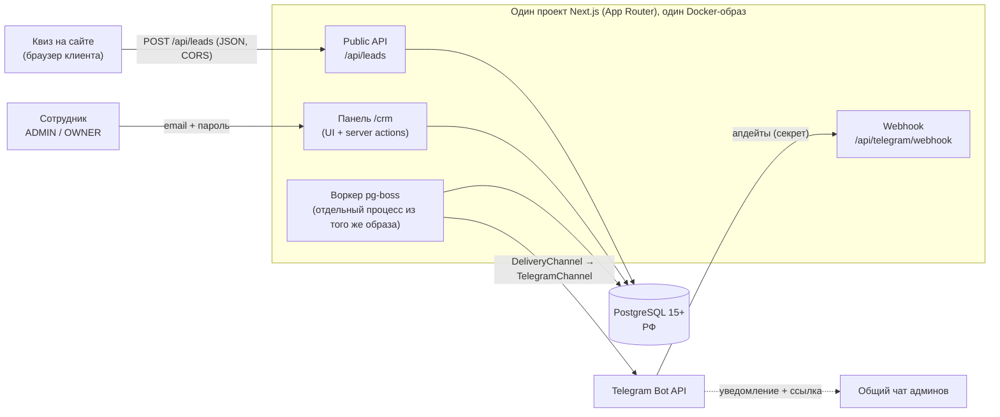
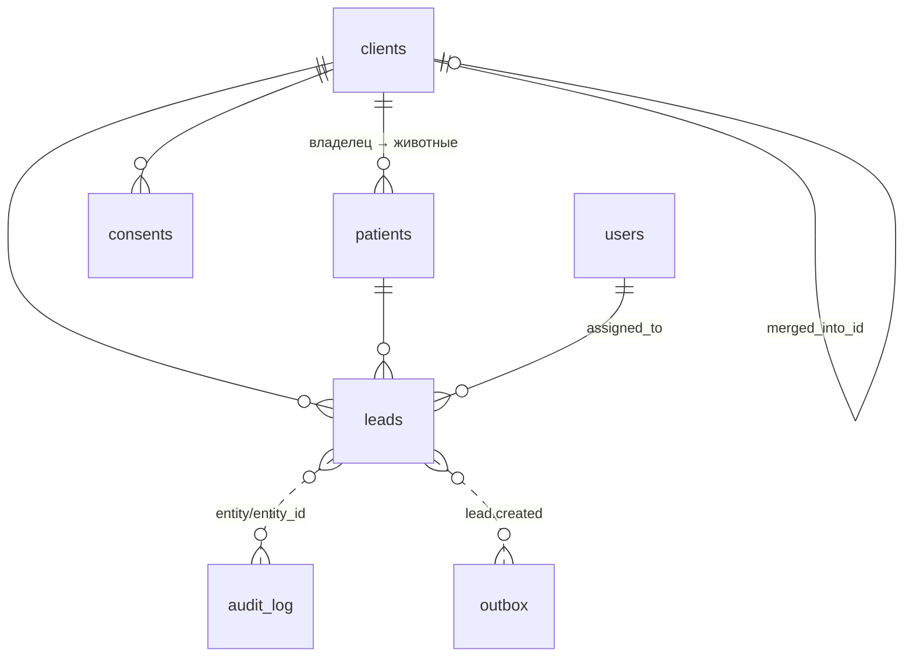
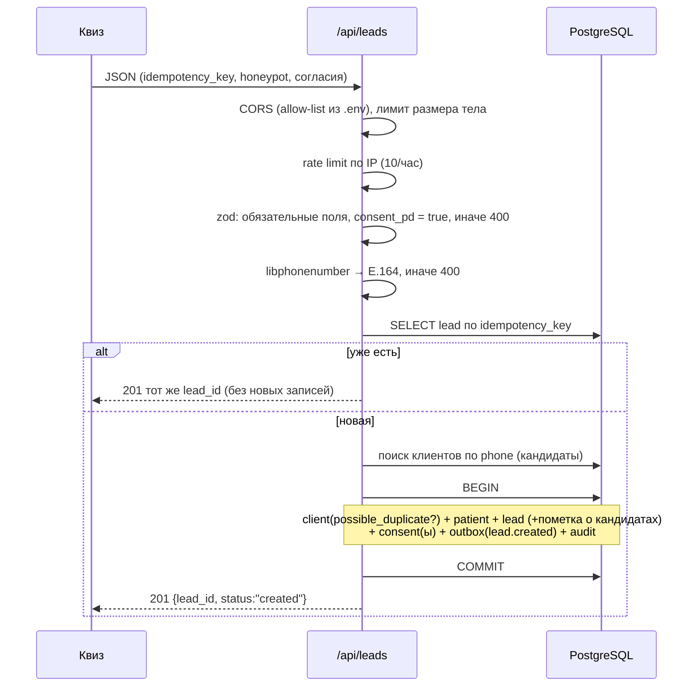
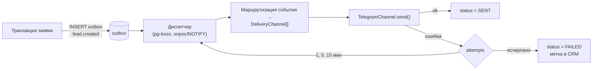
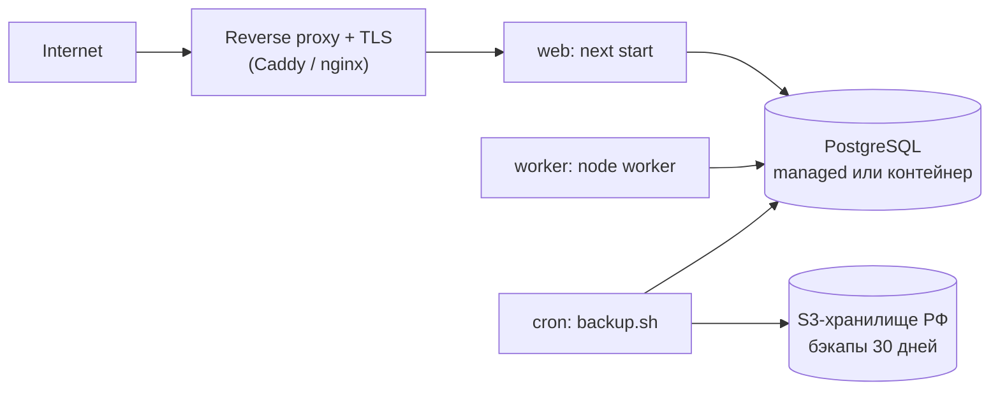

# Архитектура: сбор лидов из квиза → PostgreSQL → мини-CRM → Telegram

> Основа: «Промпт — сбор лидов из квиза.md». Согласовано с «ТЗ CRM VetPetCare v1.md» (NFR-10, раздел 9): мини-CRM — ядро будущей полной CRM, а не отдельный прототип.

## 1. Контекст и границы

**Входит в v0.1:** прием заявок из квиза, хранение, панель сотрудников, уведомление в Telegram, бэкапы, деплой в РФ.
**Не входит:** оплата, расписание, анкеты, бот для клиентов, интеграция с Yclients.



## 2. Стек и решения

| Слой | Выбор | Почему |
|---|---|---|
| Язык / рантайм | TypeScript, Node.js 20+ | как в NFR-10 ТЗ |
| Веб | Next.js App Router | API приема и панель в одном проекте |
| БД | PostgreSQL 15+ | единый источник истины и очередь |
| ORM / миграции | **Drizzle** (рекомендация) | тонкий слой, SQL-близкий, легко писать транзакции и `jsonb`; Prisma — допустимая замена |
| Очередь | pg-boss | без Redis, транзакционно с данными, ретраи |
| Валидация | zod | одна схема на API и типы |
| Телефон | libphonenumber-js (RU) | E.164 |
| Пароли | argon2 | |
| Telegram | grammY или прямой HTTP | за интерфейсом `DeliveryChannel` |
| Тесты | vitest + реальный Postgres в Docker | |
| Деплой | Docker, Yandex Cloud / Selectel, HTTPS | ПДн только в РФ |

## 3. Структура проекта

```
/
├─ docker-compose.yml          # локальный Postgres
├─ Dockerfile                  # web и worker (разные команды запуска)
├─ .env.example
├─ drizzle/                    # миграции
├─ scripts/
│  ├─ seed-admin.ts            # первый администратор (не регистрацией)
│  ├─ backup.sh                # pg_dump, ротация 30 дней
│  └─ restore.md
├─ docs/                       # деплой, удаление данных клиента, сниппет квиза
├─ src/
│  ├─ app/
│  │  ├─ api/
│  │  │  ├─ leads/route.ts             # POST — приём заявок
│  │  │  └─ telegram/webhook/route.ts  # проверка секрета
│  │  └─ crm/                          # login, leads, leads/[id], users, export
│  ├─ modules/
│  │  ├─ leads/        # service, schema (zod), repository, dedupe
│  │  ├─ clients/      # phone normalize, поиск совпадений
│  │  ├─ consents/
│  │  ├─ auth/         # сессии, rate limit входа, guard по ролям
│  │  ├─ users/
│  │  ├─ audit/        # writeAudit(tx, …)
│  │  ├─ outbox/       # enqueue(tx, event), dispatcher
│  │  └─ notifications/
│  │     ├─ channel.ts       # interface DeliveryChannel
│  │     ├─ telegram.ts      # TelegramChannel
│  │     └─ templates.ts
│  ├─ db/              # schema.ts, client, withTx()
│  ├─ lib/             # env (zod), logger (pino + маскирование), ip-hash, rate-limit, cors
│  └─ worker/index.ts  # pg-boss: outbox → каналы, ретраи
└─ tests/ (unit, integration, authz)
```

**Правило слоёв:** route/server action → `modules/*/service` → repository. Бизнес-логика и транзакции только в service; UI и роуты не ходят в БД напрямую. Модули разрезаны по доменам ТЗ, чтобы позже добавить `appointments`, `payments`, `chat` рядом.

## 4. Модель данных

Общие поля всех таблиц: `id uuid`, `created_at`, `updated_at` (UTC).



| Таблица | Ключевое |
|---|---|
| `clients` | `last_name`, `first_name` (раздельно), `phone` (E.164), `phone_raw`, `email?`, `telegram_user_id?`, `source` (QUIZ/MANUAL), `possible_duplicate`, `merged_into_id?` |
| `patients` | `client_id`, `species`, `name?`, `breed?`, `age_text?`, `weight?`, `notes?` |
| `leads` | `client_id`, `patient_id`, `status` (NEW/IN_PROGRESS/DONE/SPAM), `assigned_to?`, `quiz_version`, `raw_payload jsonb`, `utm jsonb`, `page_url`, `ip_hash`, `user_agent`, `idempotency_key` **unique**, `comment` |
| `consents` | `client_id`, `type` (PD_OFFER/MARKETING), `granted`, `document_version`, `granted_at`, `source`, `ip_hash` |
| `users` | `email` unique, `name`, `role` (ADMIN/OWNER), `password_hash`, `telegram_user_id?`, `active` |
| `outbox` | `type`, `payload jsonb`, `status` (PENDING/SENT/FAILED), `attempts`, `last_error`, `next_attempt_at` |
| `audit_log` | `actor` (user id / `system`), `entity`, `entity_id`, `action`, `before`, `after`, `at` — только INSERT |

**Индексы:** `clients(phone)`, `leads(status, created_at desc)`, `leads(idempotency_key)` unique; дополнительно `leads(assigned_to)`, `outbox(status, next_attempt_at)`.

**Справочник видов питомца:** таблица или константа `species_dictionary` (собака, кошка, грызун, птица, другое) для отчётов; в `patients.species` хранится как пришло, нормализованное значение — отдельное необязательное поле/представление.

**Сессии:** таблица `sessions` (user_id, token_hash, expires_at) либо подписанный cookie — решить на шаге 3; серверная таблица предпочтительнее (можно отзывать).

## 5. Поток приёма заявки (`POST /api/leads`)



Ключевые решения:

- **Одна транзакция** на всё; сбой любой вставки → откат полностью.
- **Идемпотентность** на двух уровнях: предварительный SELECT и unique-индекс; при гонке ловим нарушение unique и возвращаем существующую заявку.
- **Дубли:** автоматического слияния нет. Совпал телефон → новый клиент с `possible_duplicate = true`, в заявке пометка «возможный дубль: <id>».
- **Антиспам:** honeypot / rate limit / подозрительные → статус `SPAM` (данные сохраняются). Точка подключения капчи (Turnstile / SmartCaptcha) — интерфейс `CaptchaVerifier`, по умолчанию no-op.
- **Ответ** не содержит ПДн. **Логи** — структурные, с `lead_id`, телефон и ФИО маскируются.
- IP хранится только как `ip_hash` (HMAC с солью из env).

## 6. Мини-CRM `/crm`

- **Аутентификация:** email + пароль (argon2), серверные сессии с истечением, троттлинг входа. Пользователей создаёт сид/OWNER.
- **Авторизация:** единая функция `requireRole()` в каждом route handler и server action — проверка на сервере, не в UI. Middleware только редиректит неавторизованных; данные без сессии не отдаются ни UI, ни API.
- **Экраны:** список заявок (фильтры: статус, дата, источник; поиск по телефону/ФИО; пагинация; метка дубля; UTM), карточка (поля, кандидаты в дубли, смена статуса, ответственный, комментарий, история из `audit_log`, статус доставки в Telegram), CSV-выгрузка с текущим фильтром, управление пользователями (только OWNER).
- **Каждое изменение** (статус, ответственный, комментарий) — в одной транзакции с записью в `audit_log` (before/after).
- UI на русском, адаптивный (mobile-first таблица → карточки).

| Действие | ADMIN | OWNER |
|---|---|---|
| Просмотр/обработка заявок, CSV | ✅ | ✅ |
| Пользователи | ❌ | ✅ |

## 7. Outbox и Telegram



- `interface DeliveryChannel { send(target, message): Promise<Result> }`. Сейчас одна реализация — `TelegramChannel`; email и др. добавляются без изменения сценариев (NFR-09 ТЗ).
- Сообщение: «Новая заявка: Фамилия Имя, телефон, вид питомца, источник, ссылка на карточку».
- Токен бота и ID чата — только из env. Webhook `/api/telegram/webhook` с проверкой заголовка секрета.
- Заявка не теряется при недоступности Telegram: событие лежит в `outbox`, `FAILED` виден в карточке и списке.
- Задел на будущее (не делаем): deep link `t.me/<bot>?start=<token>`, `clients.telegram_user_id`, двусторонняя переписка.

## 8. Безопасность и ПДн

- Хостинг, БД и бэкапы в РФ; HTTPS; секреты только в env (`.env` вне репозитория).
- Согласия: обязательное ПДн/оферта (с версией документа и временем), отдельное необязательное маркетинговое (по умолчанию выключено).
- Нет ПДн в URL и логах. Размер тела ограничен. Параметризованные запросы (ORM), экранирование в UI, secure/httpOnly/SameSite cookie, CSRF-защита server actions.
- Бэкапы: `pg_dump` по расписанию, хранение 30 дней, проверенное восстановление, инструкция.
- Памятка «удаление данных клиента»: что чистить (`clients`, `patients`, `leads.raw_payload`, `consents`, связанные `audit_log`/`outbox`), как фиксировать факт удаления без ПДн.

## 9. Конфигурация (`.env.example`)

`DATABASE_URL`, `SESSION_SECRET`, `IP_HASH_SALT`, `ALLOWED_ORIGINS`, `APP_BASE_URL`, `TELEGRAM_BOT_TOKEN`, `TELEGRAM_ADMIN_CHAT_ID`, `TELEGRAM_WEBHOOK_SECRET`, `RATE_LIMIT_PER_HOUR`, `CAPTCHA_PROVIDER` (none), `PD_DOCUMENT_VERSION`; env валидируется zod при старте.

## 10. Тестовая стратегия

| Уровень | Что проверяем |
|---|---|
| Unit | нормализация телефона; zod-схема payload; поиск совпадений |
| Интеграция (реальный Postgres) | создание заявки; повтор с тем же ключом без дубля; дубль по телефону → `possible_duplicate`; нет согласия → 400; откат транзакции при сбое; rate limit; ретраи outbox |
| Права | без входа нет данных ни через UI, ни через API; USER-only маршруты закрыты для ADMIN |

## 11. Деплой



Один образ, два процесса (`web`, `worker`). Миграции — отдельным шагом перед запуском. Здоровье: `/api/health`.

## 12. План реализации (по шагам промпта)

| # | Шаг | Результат / проверка |
|---|---|---|
| 1 | Каркас, docker-compose, миграции, сид админа | `docker compose up`, вход возможен |
| 2 | `POST /api/leads` + тесты | все интеграционные сценарии зелёные |
| 3 | Панель `/crm`: вход, список, карточка, CSV, пользователи | проверка прав |
| 4 | Сниппет для квиза (`fetch`) и описание полей | тестовая отправка с сайта |
| 5 | Outbox + воркер + Telegram | уведомление приходит; симуляция сбоя → ретраи → FAILED |
| 6 | Dockerfile, деплой, бэкапы, восстановление | README, памятка удаления данных |

## 13. Заделы под полную CRM (из ТЗ)

| Сейчас | Дальше |
|---|---|
| `clients` / `patients` разделены | единая база клиент → животные (Р-1, Р-20) |
| `possible_duplicate`, `merged_into_id` | задача «Проверить совпадение», ручное слияние (FR-15/16) |
| `users.role` ADMIN/OWNER | + SPECIALIST (Р-22) |
| `outbox` + `DeliveryChannel` | сценарные сообщения С-1…С-3, email |
| `audit_log` | аудит всех сущностей (FR-82) |
| `clients.telegram_user_id` | привязка бота, чат |
| `leads` | конверсия лида → запись (appointment) |

## 14. Открытые вопросы (решить до/в ходе работы)

1. Drizzle или Prisma — окончательный выбор.
2. Где хостим: Yandex Cloud или Selectel; managed PostgreSQL или контейнер.
3. Домен(ы) сайта для CORS и URL оферты/политики (ОВ-9 ТЗ), версия документа.
4. Нужна ли капча на старте.
5. Как квиз передаёт UTM (сам квиз или сайт) и на чём он построен.
6. Telegram-бот и общий чат админов — создаёт команда; нужен токен и chat id.
7. Серверные сессии (таблица) vs подписанный cookie.
